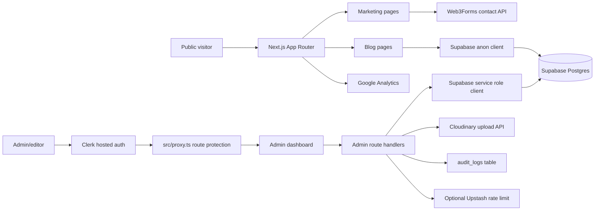
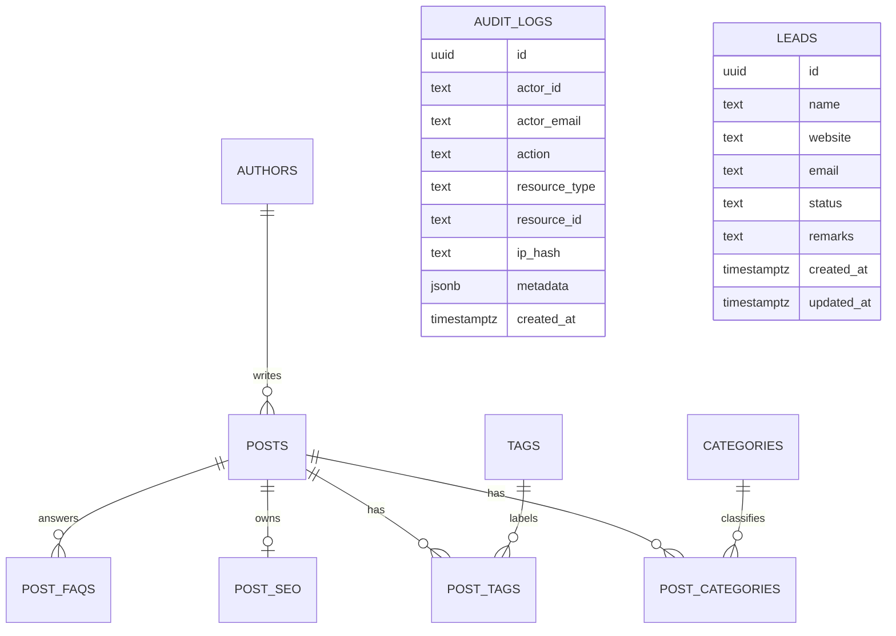
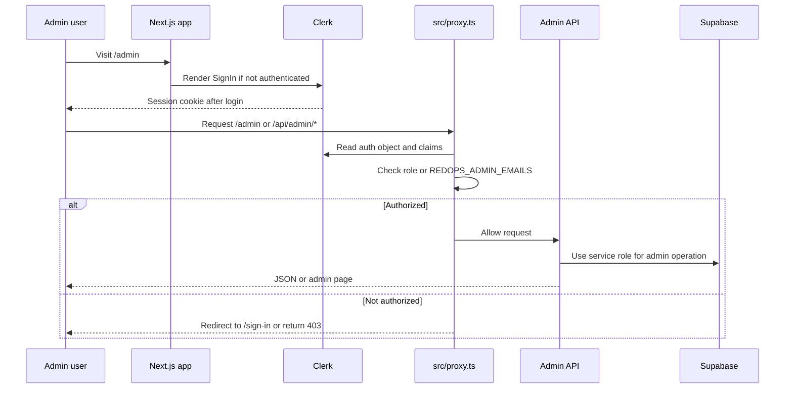
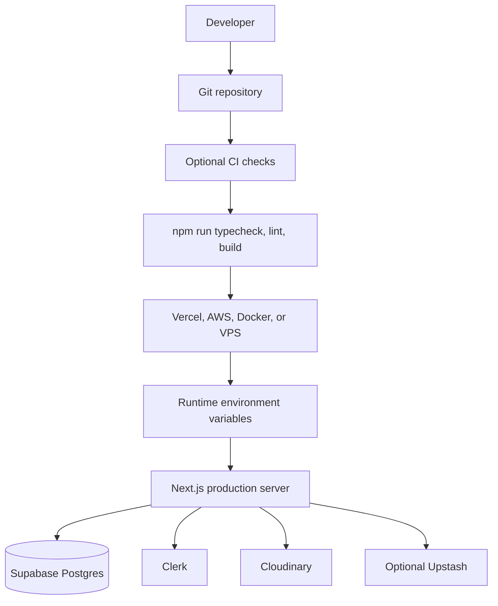

<<<<<<< HEAD
# RedOps Security

> Offensive security, penetration testing, and cybersecurity research platform for RedOps Security.
=======
# 🛡️ RedOps Security

> **Cybersecurity & Threat Intelligence Platform**
>>>>>>> d20ba49595f7dd634aaf8945b5ce59d7c06e56d9

[](https://nextjs.org/)
[](https://react.dev/)
[](https://www.typescriptlang.org/)
[](https://supabase.com/)
[](https://clerk.com/)
[](https://vercel.com/)

## Overview

RedOps Security is a production-oriented cybersecurity company website and editorial CMS built with Next.js App Router. It serves two audiences:

- Prospective clients evaluating offensive security services such as web application pentesting, mobile testing, cloud security, network VAPT, red team operations, GRC, ISO 27001 implementation, and secure development.
- RedOps operators and editors who need a protected admin dashboard for publishing research, managing authors and taxonomy, uploading Cloudinary images, and maintaining lead lists.

The repository combines a high-conversion marketing site, a Supabase-backed blog, an authenticated admin panel, public SEO surfaces, and server-side API routes. The project solves the problem of giving a cybersecurity services company a fast public website while keeping editorial and operational workflows inside a controlled admin interface.

The live site URL is configured as `https://redops.in` in the application metadata.

## Features

### Public Website

- Home page with an animated Three.js globe and cybersecurity-focused conversion copy.
- Responsive navigation with mobile menu support.
- Light and dark theme support persisted in `localStorage`.
- Service pages for:
  - Network VAPT
  - Mobile application security
  - Web application penetration testing
  - Cloud security assessments
  - Red team operations
  - GRC and compliance
  - ISO 27001 implementation
  - Secure development lifecycle services
- Industry pages for SaaS and fintech.
- About page, methodology page, contact page, privacy policy, terms of service, and responsible disclosure page.
- Contact form integration with Web3Forms and hCaptcha.
- Google Analytics integration through `gtag`.
- SEO metadata for major static routes.
- Organization JSON-LD schema.
- Sitemap, robots.txt, RSS feed, Open Graph metadata, and Twitter card metadata.

### Blog and Research CMS

- Public `/blog` index with pagination, search, category filters, and tag filters.
- Dynamic article pages at `/blog/[slug]`.
- Category landing pages at `/blog/category/[slug]`.
- Tag landing pages at `/blog/tag/[slug]`.
- Author profile pages that combine database-backed authors with static author data.
- Markdown rendering with GitHub Flavored Markdown support.
- Code highlighting through `rehype-highlight` and `highlight.js`.
- Article table of contents generated from Markdown headings.
- Related posts based on shared taxonomy.
- Article FAQ rendering and FAQ JSON-LD.
- BlogPosting JSON-LD and breadcrumb JSON-LD.
- RSS feed at `/rss.xml`.
- Sitemap entries for published blog posts.
- Reading-time estimation.
- Cloudinary and Supabase image URL transformation helpers.

### Admin Dashboard

- Clerk-protected admin surface under `/admin`.
- Admin dashboard with counts for posts, published posts, categories, tags, and authors.
- Post creation, editing, deletion, publishing, scheduling metadata, featured flag, author assignment, category assignment, tag assignment, SEO fields, and image URL management.
- Taxonomy management for categories and tags.
- Author management.
- Lead management dashboard.
- CSV/XLSX lead upload with automatic column detection.
- Lead status updates, remarks, single delete, and bulk delete.
- Cloudinary image upload endpoint with file type and size validation.
- Manual cache revalidation endpoint.
- Audit logging for important admin actions.

### Security and Operations

- Clerk authentication and role/email-based admin authorization.
- Protected admin and admin API routes through `src/proxy.ts`.
- Supabase Row Level Security for public read access to published content.
- Server-side Supabase service role usage for admin writes only.
- Zod validation for public search and image uploads.
- Same-origin checks for image upload and manual revalidation.
- Rate limiting with optional Upstash Redis REST backend and local in-memory fallback.
- Content Security Policy, HSTS in production, referrer policy, permissions policy, and other security headers.
- Admin activity audit logs with hashed IP addresses.
- Next.js ISR/revalidation for blog routes and feeds.
- Next.js image optimization with configured remote patterns.

## Screenshots

Add real screenshots under `docs/screenshots/` and update the image paths below before publishing the repository.

| Screen | Placeholder | Recommended Capture |
| --- | --- | --- |
| Homepage | `docs/screenshots/homepage.png` | First viewport with animated hero, nav, and primary CTA |
| Services | `docs/screenshots/services.png` | Services grid and secure development section |
| Blog Index | `docs/screenshots/blog-index.png` | Search, filters, pagination, and post cards |
| Blog Article | `docs/screenshots/blog-article.png` | Article hero, table of contents, Markdown body, related posts |
| Admin Dashboard | `docs/screenshots/admin-dashboard.png` | Authenticated dashboard overview |
| Post Editor | `docs/screenshots/post-editor.png` | Admin post form with taxonomy and SEO fields |
| Leads Manager | `docs/screenshots/leads-manager.png` | CSV/XLSX import and lead table |

```md


```

## Architecture

RedOps Security is a monolithic Next.js application. The public marketing site, blog, admin dashboard, and API routes live in the same App Router project. Supabase provides PostgreSQL persistence and row-level authorization. Clerk handles identity and sessions. Cloudinary handles secure editorial image uploads. Vercel is the intended hosting platform based on `vercel.json`, Next.js configuration, and App Router deployment patterns.



### Component Interaction

- `src/app` defines all App Router pages, layouts, route handlers, metadata routes, and loading/error boundaries.
- `src/views` contains the branded marketing page implementations used by App Router pages.
- `src/components/blog` renders the public editorial experience.
- `src/components/admin` renders authenticated admin workflows.
- `src/lib/db` contains Supabase data access helpers.
- `src/lib/security` contains authorization, CSRF, rate limiting, and validation helpers.
- `src/lib/blog` contains SEO, formatting, Markdown, and content utilities.
- `supabase/*.sql` defines the database schema and supporting cleanup migrations.

## Tech Stack

| Layer | Technology |
| --- | --- |
| Frontend | Next.js 16 App Router, React 19, TypeScript, CSS, Tailwind CSS utility configuration, Heroicons, Three.js |
| Backend | Next.js Route Handlers, Server Components, Node.js runtime for Cloudinary routes |
| Database | Supabase PostgreSQL, Row Level Security, SQL migrations, GIN full-text search index |
| Authentication | Clerk, Clerk middleware/proxy, Clerk session cookies, role and email allowlist authorization |
| Hosting | Vercel inferred from `vercel.json` and Next.js configuration |
| DevOps | npm scripts, ESLint flat config, TypeScript strict mode, Vercel headers, manual Supabase SQL migrations |
| CMS | Custom Supabase-backed admin dashboard |
| Media | Cloudinary uploads and transformations, Supabase-compatible image helper |
| Forms | Web3Forms contact form, hCaptcha script, React Hook Form for Cloudinary upload validation |
| Analytics | Google Analytics via `gtag` |
| Rate Limiting | Optional Upstash Redis REST with local in-memory fallback |

## Third-Party Integrations

| Integration | Purpose | Where Used |
| --- | --- | --- |
| Supabase | PostgreSQL database, public reads, admin writes through service role | `src/lib/supabase.ts`, `src/lib/db/*`, `supabase/*.sql` |
| Clerk | Admin authentication, sign-in/sign-up UI, session protection | `src/proxy.ts`, `src/app/sign-in`, `src/app/sign-up`, `src/lib/security/admin.ts` |
| Cloudinary | Secure blog image uploads and optimized delivery | `src/app/api/admin/images/route.ts`, `src/components/admin/CloudinaryUploadField.tsx` |
| Upstash Redis REST | Optional distributed rate limiting | `src/lib/security/rate-limit.ts` |
| Web3Forms | Public contact form submissions and hCaptcha | `src/views/Contact.tsx` |
| Google Analytics | Public site analytics | `src/app/layout.tsx` |
| Vercel | Hosting and platform headers | `vercel.json`, `next.config.ts` |

## Folder Structure

```text
redops-security/
|-- docs/
|   `-- blog-cms-architecture.md
|-- public/
|   |-- favicon.png
|   |-- favicon.svg
|   |-- icons.svg
|   |-- og-image.png
|   |-- llms.txt
|   |-- earth_texture.jpg
|   |-- earth_normal.jpg
|   `-- earth_specular.jpg
|-- src/
|   |-- app/
|   |   |-- admin/
|   |   |-- api/
|   |   |-- authors/
|   |   |-- blog/
|   |   |-- contact/
|   |   |-- industries/
|   |   |-- services/
|   |   |-- sign-in/
|   |   |-- sign-up/
|   |   |-- layout.tsx
|   |   |-- page.tsx
|   |   |-- robots.ts
|   |   `-- sitemap.ts
|   |-- assets/
|   |-- components/
|   |   |-- admin/
|   |   `-- blog/
|   |-- context/
|   |-- data/
|   |-- lib/
|   |   |-- blog/
|   |   |-- db/
|   |   `-- security/
|   |-- types/
|   |-- views/
|   |-- index.css
|   |-- proxy.ts
|   `-- seo.ts
|-- supabase/
|   |-- migration.sql
|   |-- leads_migration.sql
|   `-- seo_content_cleanup.sql
|-- .env.example
|-- .gitignore
|-- eslint.config.js
|-- next.config.ts
|-- package.json
|-- postcss.config.mjs
|-- tailwind.config.ts
|-- tsconfig.json
`-- vercel.json
```

### Major Folder Purposes

- `docs/`: Architecture notes for the Supabase-backed CMS.
- `public/`: Static assets served from the site root, including SEO images, icons, and Three.js earth textures.
- `src/app/`: Next.js App Router pages, layouts, loading/error states, API routes, RSS route, sitemap, and robots metadata.
- `src/app/admin/`: Authenticated admin dashboard pages.
- `src/app/api/`: Public and admin route handlers.
- `src/assets/`: Imported image assets used by React components.
- `src/components/`: Shared UI components. Blog and admin features have dedicated subfolders.
- `src/context/`: React context providers, currently theme state.
- `src/data/`: Static author fallback data.
- `src/lib/blog/`: Blog formatting, SEO, content cleanup, reading time, and table-of-contents helpers.
- `src/lib/db/`: Supabase data access layer.
- `src/lib/security/`: Clerk admin authorization, same-origin checks, rate limiting, and Zod validators.
- `src/types/`: Shared TypeScript domain types.
- `src/views/`: Branded page-level marketing views.
- `supabase/`: SQL migrations and cleanup scripts for the Supabase database.

## Installation

### Prerequisites

- Node.js 20 or newer recommended.
- npm 10 or newer.
- Supabase project with SQL Editor access.
- Clerk application for admin authentication.
- Cloudinary account for image uploads.
- Web3Forms access key for the public contact form.
- Optional Upstash Redis REST database for distributed rate limiting.
- Vercel account for the easiest production deployment.

### Clone Repository

```bash
git clone https://github.com/<owner>/redops-security.git
cd redops-security
```

### Install Dependencies

```bash
npm install
```

### Environment Variables

Create a local environment file:

```bash
cp .env.example .env.local
```

Use the following `.env.example` as the source of truth:

```env
NEXT_PUBLIC_SITE_URL=https://redops.in

# Supabase CMS (PostgreSQL)
NEXT_PUBLIC_SUPABASE_URL=https://your-project.supabase.co
NEXT_PUBLIC_SUPABASE_ANON_KEY=your-anon-key
SUPABASE_SERVICE_ROLE_KEY=your-service-role-key
BLOG_REVALIDATE_SECONDS=300

# Clerk admin auth
NEXT_PUBLIC_CLERK_PUBLISHABLE_KEY=pk_test_...
CLERK_SECRET_KEY=sk_test_...
NEXT_PUBLIC_CLERK_SIGN_IN_URL=/sign-in
NEXT_PUBLIC_CLERK_SIGN_UP_URL=/sign-up
REDOPS_ADMIN_EMAILS=admin@redops.in

# Cloudinary secure image uploads
CLOUDINARY_CLOUD_NAME=your_cloud_name
CLOUDINARY_API_KEY=your_api_key
CLOUDINARY_API_SECRET=your_api_secret

# Optional distributed rate limiting for Vercel/serverless
UPSTASH_REDIS_REST_URL=https://your-upstash-url
UPSTASH_REDIS_REST_TOKEN=your_upstash_token

# Existing analytics
NEXT_PUBLIC_GA_ID=G-XXXXXXXXXX
```

Additional runtime values:

- `VERCEL_URL` is automatically provided by Vercel and is used by same-origin checks.
- `NODE_ENV=production` enables HSTS headers in `next.config.ts`.

Secrets note: `.env` is ignored in `.gitignore`, but this checkout still has `.env` tracked by Git. Before publishing or open-sourcing, remove it from version control with `git rm --cached .env`, rotate any exposed secrets, and keep only `.env.example` committed.

### Run Development Server

```bash
npm run dev
```

Open `http://localhost:3000`.

### Build for Production

```bash
npm run typecheck
npm run lint
npm run build
npm run start
```

### Production Deployment

The application is designed for a standard Next.js production build. Vercel is the primary target, but AWS, Docker, and a VPS are also possible with the instructions below.

## Database Setup

The database is Supabase PostgreSQL. There is no Prisma, Drizzle, or ORM migration runner in this repository. Migrations are plain SQL files intended to be run in the Supabase SQL Editor or through the Supabase CLI.

### Migration Order

Run the SQL files in this order:

1. `supabase/migration.sql`
2. `supabase/leads_migration.sql`
3. `supabase/seo_content_cleanup.sql` only if the existing production content needs those cleanup operations.

`leads_migration.sql` depends on the `update_updated_at()` function created by `migration.sql`, so the base migration must run first.

### Schema Summary

| Table | Purpose |
| --- | --- |
| `authors` | Blog author profiles, credentials, image URLs, and social links |
| `categories` | Blog categories |
| `tags` | Blog tags |
| `posts` | Blog articles with status, slug, excerpt, Markdown body, image fields, author, publish timestamps, and generated search vector |
| `post_categories` | Many-to-many post to category join table |
| `post_tags` | Many-to-many post to tag join table |
| `post_seo` | One-to-one SEO metadata for posts |
| `post_faqs` | FAQ entries for posts |
| `audit_logs` | Admin action audit trail |
| `leads` | Uploaded lead list with status and remarks |

### Database Relationships



### Indexes and Search

- Slug indexes exist for authors, categories, tags, and posts.
- Post status and published date indexes support public listing queries.
- Featured post and author indexes support ordering and author pages.
- `posts.search_vector` is a generated `tsvector` column.
- `idx_posts_search` is a GIN index for full-text search.
- `idx_audit_logs_created` supports recent audit log queries.
- `idx_leads_status` supports lead filtering by status.

### RLS Policies

- Public read access is enabled for authors, categories, tags, joins, post SEO, post FAQs, and published posts.
- Public post reads are restricted to `status = 'published'` and `published_at <= now()`.
- Audit logs are not publicly readable.
- Admin writes are performed through server-side route handlers using the Supabase service role key after Clerk authorization.

Security note: `leads_migration.sql` currently creates a public read policy for `leads`. If lead data is sensitive, restrict the `leads` table to service-role/admin access before production use.

### Seeders

No seed script is committed. Initial authors, categories, tags, and posts can be inserted through the Supabase SQL Editor or the authenticated admin dashboard after deployment.

## API Documentation

Base URL for local development: `http://localhost:3000`

Admin endpoints require an authenticated Clerk admin session. Access is granted when one of the following is true:

- Clerk organization role is `org:admin`.
- Clerk metadata role is `admin`, `redops_admin`, or `security_admin`.
- User email is listed in `REDOPS_ADMIN_EMAILS`.

### Endpoint Summary

| Method | Endpoint | Description |
| --- | --- | --- |
| GET | `/api/blog/search` | Public blog search with query, page, category, and tag filters |
| GET | `/rss.xml` | Public RSS feed for recent published posts |
| GET | `/sitemap.xml` | Next.js generated sitemap including static routes and published posts |
| GET | `/robots.txt` | Robots metadata disallowing admin/auth/API admin surfaces |
| GET | `/api/admin/posts` | List admin post summaries |
| POST | `/api/admin/posts` | Create a post and related taxonomy/SEO rows |
| GET | `/api/admin/posts/{id}` | Fetch one post with category IDs, tag IDs, and SEO data |
| PUT | `/api/admin/posts/{id}` | Update a post, taxonomy links, and SEO data |
| DELETE | `/api/admin/posts/{id}` | Delete a post |
| GET | `/api/admin/categories` | List categories |
| POST | `/api/admin/categories` | Create a category |
| PUT | `/api/admin/categories/{id}` | Update a category |
| DELETE | `/api/admin/categories/{id}` | Delete a category |
| GET | `/api/admin/tags` | List tags |
| POST | `/api/admin/tags` | Create a tag |
| PUT | `/api/admin/tags/{id}` | Update a tag |
| DELETE | `/api/admin/tags/{id}` | Delete a tag |
| GET | `/api/admin/authors` | List authors |
| POST | `/api/admin/authors` | Create an author |
| PUT | `/api/admin/authors/{id}` | Update an author |
| DELETE | `/api/admin/authors/{id}` | Delete an author |
| GET | `/api/admin/leads` | List leads |
| POST | `/api/admin/leads` | Bulk insert leads |
| DELETE | `/api/admin/leads` | Bulk delete leads by IDs |
| PATCH | `/api/admin/leads/{id}` | Update lead status or remarks |
| DELETE | `/api/admin/leads/{id}` | Delete one lead |
| POST | `/api/admin/images` | Upload one validated image to Cloudinary |
| POST | `/api/admin/revalidate` | Revalidate blog, author, sitemap, and RSS paths |

### Public Search Example

Request:

```bash
curl "http://localhost:3000/api/blog/search?q=cloud&page=1&category=research&tag=aws"
```

Response:

```json
{
  "posts": [
    {
      "_id": "8c2c9f1e-1111-4444-9999-123456789abc",
      "title": "Cloud IAM Escalation Paths",
      "slug": "cloud-iam-escalation-paths",
      "excerpt": "A field guide to cloud privilege escalation...",
      "publishedAt": "2026-05-20T10:00:00.000Z",
      "featured": false,
      "readingTime": "6 min",
      "categories": [{ "title": "Research", "slug": "research" }],
      "tags": [{ "title": "AWS", "slug": "aws" }]
    }
  ],
  "total": 1,
  "categories": [],
  "tags": [],
  "page": 1,
  "pageSize": 9,
  "totalPages": 1
}
```

Errors:

```json
{ "error": "Invalid search query" }
```

```json
{ "error": "Too many search attempts" }
```

### Create Post Example

Requires authenticated admin session.

Request:

```http
POST /api/admin/posts
Content-Type: application/json
```

```json
{
  "title": "WordPress XML-RPC Attack Surface",
  "slug": "wordpress-xml-rpc-attack-surface",
  "excerpt": "A practical look at common XML-RPC exposure patterns.",
  "body": "## Overview\nMarkdown body content...",
  "status": "draft",
  "featured": false,
  "reading_time": "5 min",
  "image_url": "https://res.cloudinary.com/example/image/upload/redops/blog/xmlrpc.png",
  "image_alt": "Terminal output showing XML-RPC probing",
  "author_id": "author-uuid",
  "category_ids": ["category-uuid"],
  "tag_ids": ["tag-uuid"],
  "seo_meta_title": "WordPress XML-RPC Attack Surface | RedOps",
  "seo_meta_description": "How attackers abuse XML-RPC and how defenders can reduce exposure.",
  "seo_canonical_path": "/blog/wordpress-xml-rpc-attack-surface"
}
```

Response:

```json
{
  "data": {
    "id": "post-uuid"
  }
}
```

### Update Post Example

```http
PUT /api/admin/posts/post-uuid
Content-Type: application/json
```

```json
{
  "title": "Updated title",
  "slug": "updated-title",
  "excerpt": "Updated excerpt",
  "body": "Updated Markdown body",
  "status": "published",
  "featured": true,
  "published_at": "2026-05-29T10:00",
  "category_ids": [],
  "tag_ids": []
}
```

Response:

```json
{ "success": true }
```

### Taxonomy Example

```http
POST /api/admin/categories
Content-Type: application/json
```

```json
{
  "title": "Cloud Security",
  "description": "AWS, Azure, GCP, Kubernetes, and cloud-native security research."
}
```

Response:

```json
{
  "data": {
    "id": "category-uuid",
    "title": "Cloud Security",
    "slug": "cloud-security"
  }
}
```

The tag endpoints use the same request and response shape under `/api/admin/tags`.

### Author Example

```http
POST /api/admin/authors
Content-Type: application/json
```

```json
{
  "name": "RedOps Research Team",
  "role": "Offensive Security Research",
  "bio": "Practitioner-written vulnerability research and field notes.",
  "credentials": ["OSCP", "CRTO"],
  "image_url": "https://res.cloudinary.com/example/image/upload/redops/authors/team.png",
  "linkedin": "https://www.linkedin.com/company/redops-security"
}
```

Response:

```json
{
  "data": {
    "id": "author-uuid",
    "name": "RedOps Research Team",
    "slug": "redops-research-team"
  }
}
```

### Lead Upload Example

```http
POST /api/admin/leads
Content-Type: application/json
```

```json
[
  {
    "name": "Acme Security",
    "website": "https://acme.example",
    "email": "security@acme.example",
    "status": "not_tested"
  }
]
```

Response:

```json
{
  "data": [
    {
      "id": "lead-uuid",
      "name": "Acme Security",
      "website": "https://acme.example",
      "email": "security@acme.example",
      "status": "not_tested",
      "created_at": "2026-05-29T10:00:00.000Z"
    }
  ]
}
```

### Lead Update Example

```http
PATCH /api/admin/leads/lead-uuid
Content-Type: application/json
```

```json
{
  "status": "tested",
  "remarks": "Initial review complete."
}
```

Response:

```json
{
  "data": {
    "id": "lead-uuid",
    "status": "tested",
    "remarks": "Initial review complete."
  }
}
```

### Image Upload Example

```http
POST /api/admin/images
Content-Type: multipart/form-data
```

Form field:

```text
file=@hero-image.webp
```

Response:

```json
{
  "image": {
    "publicId": "redops/blog/hero-image",
    "secureUrl": "https://res.cloudinary.com/example/image/upload/v123/redops/blog/hero-image.webp",
    "url": "http://res.cloudinary.com/example/image/upload/v123/redops/blog/hero-image.webp",
    "width": 1400,
    "height": 760,
    "format": "webp",
    "bytes": 204800
  }
}
```

Validation rules:

- One file only.
- Max size: 5 MB.
- Allowed MIME types: `image/jpeg`, `image/png`, `image/webp`, `image/avif`.

### Manual Revalidation Example

```http
POST /api/admin/revalidate
Content-Type: application/json
```

```json
{
  "slug": "wordpress-xml-rpc-attack-surface"
}
```

Response:

```json
{
  "revalidated": true,
  "slug": "wordpress-xml-rpc-attack-surface"
}
```

## Authentication

Authentication is handled by Clerk.



### Admin Authorization Model

`src/lib/security/admin.ts` grants admin access through:

- Clerk organization role: `org:admin`
- Clerk session or metadata role: `admin`, `redops_admin`, `security_admin`
- Email allowlist from `REDOPS_ADMIN_EMAILS`

### Sessions and JWTs

The application does not implement custom password storage or hand-rolled JWT issuance. Clerk owns session security, identity verification, cookies, and auth UI. The app consumes Clerk session claims to authorize admin access.

### Sign-In and Sign-Up Routes

- `/sign-in/[[...sign-in]]`
- `/sign-up/[[...sign-up]]`

Both pages are marked `noindex`.

## Security

### Authentication Security

- Clerk handles authentication and session management.
- Admin routes and admin APIs are protected by `src/proxy.ts`.
- Unauthenticated users are redirected to `/sign-in`.
- Authenticated users without admin permission receive `403 Forbidden`.

### Authorization Model

- Admin API routes call `requireAdminActor()`.
- Admin writes use the Supabase service role key only on the server.
- Public database access goes through the Supabase anon key and RLS policies.

### Input Validation

- `blogSearchSchema` validates public search input.
- `imageUploadSchema` validates Cloudinary upload metadata.
- `CloudinaryUploadField` validates file inputs with React Hook Form and Zod.
- Several admin CRUD endpoints still trust form-controlled JSON and database constraints. Add Zod schemas to every mutating admin endpoint before accepting untrusted API clients.

### Rate Limiting

Implemented in `src/lib/security/rate-limit.ts`.

| Endpoint | Limit |
| --- | --- |
| `/api/blog/search` | 120 requests per IP per 60 seconds |
| `/api/admin/images` | 20 upload attempts per IP per 60 seconds |
| `/api/admin/revalidate` | 10 revalidation attempts per IP per 60 seconds |

If `UPSTASH_REDIS_REST_URL` and `UPSTASH_REDIS_REST_TOKEN` are configured, limits are distributed through Upstash. Otherwise, a local in-memory fallback is used.

### CSRF Protection

- Same-origin checks are implemented through `assertSameOrigin()`.
- The image upload and revalidation endpoints enforce same-origin checks.
- Recommended hardening: apply the same same-origin check to all mutating admin CRUD endpoints.

### XSS Protection

- React escapes rendered content by default.
- Markdown uses `react-markdown` without raw HTML rendering.
- External Markdown links use `target="_blank"` with `rel="noopener noreferrer"`.
- A Content Security Policy is generated in `next.config.ts`.

### Security Headers

Configured in `next.config.ts` and `vercel.json`:

- `Content-Security-Policy`
- `Referrer-Policy`
- `X-Content-Type-Options`
- `X-Frame-Options`
- `X-DNS-Prefetch-Control`
- `Permissions-Policy`
- `Strict-Transport-Security` in production
- `poweredByHeader: false`

Note: `next.config.ts` sets `X-Frame-Options: SAMEORIGIN`, while `vercel.json` sets `DENY`. Confirm the effective deployed header and keep one intended policy.

### Secrets Management

- Never expose `SUPABASE_SERVICE_ROLE_KEY`, `CLERK_SECRET_KEY`, `CLOUDINARY_API_SECRET`, or `UPSTASH_REDIS_REST_TOKEN` to client code.
- Only `NEXT_PUBLIC_*` variables are safe for browser exposure.
- Move the Web3Forms access key out of `src/views/Contact.tsx` if the key should not be public.
- Remove tracked `.env` files before publishing the repository.

## Performance

### Caching

- Blog listing and article pages use `revalidate = 60`.
- RSS feed uses `revalidate = 900`.
- Taxonomy helpers use `unstable_cache()` with one-hour revalidation.
- Manual revalidation endpoint refreshes `/blog`, individual post pages, `/authors`, `/sitemap.xml`, and `/rss.xml`.

### Database Optimization

- Indexed slugs and status fields support route and listing lookups.
- Generated `search_vector` and GIN index support full-text search.
- Public listing queries paginate with a default page size of 9.
- Related post queries are limited to 3 posts.
- RSS is limited to 25 recent posts.

### Frontend Optimization

- Next.js App Router provides route-level code splitting.
- `next/image` is used for logos, blog cards, blog hero images, and Markdown images.
- The Three.js hero canvas is dynamically imported with `ssr: false`.
- Google fonts use `next/font` with `display: swap`.
- Cloudinary images receive automatic format and quality transformation parameters.
- Supabase Storage URLs receive width, height, resize, and quality query parameters when supported.

### Background Jobs

No background worker system is present. Cache revalidation and audit writes are performed inside request handlers.

## Deployment

### Vercel

Vercel is the recommended deployment target.

1. Push the repository to GitHub.
2. Import the project in Vercel.
3. Set all environment variables from `.env.example` in the Vercel dashboard.
4. Run the Supabase SQL migrations.
5. Configure Clerk production URLs:
   - Sign in URL: `/sign-in`
   - Sign up URL: `/sign-up`
   - After sign in URL: `/admin`
6. Configure Cloudinary credentials.
7. Optionally configure Upstash Redis REST credentials.
8. Deploy.

Recommended Vercel build command:

```bash
npm run build
```

Recommended output setting: use the default Next.js framework preset.

### AWS

Two practical AWS options are available.

#### AWS Amplify Hosting

1. Connect the GitHub repository to Amplify.
2. Choose the Next.js hosting preset.
3. Add environment variables from `.env.example`.
4. Use `npm run build` as the build command.
5. Run Supabase migrations separately.
6. Point the production domain to Amplify.

#### AWS ECS or App Runner

Because no Dockerfile is committed, create one using the Docker section below. Then:

1. Build and push the image to Amazon ECR.
2. Create an ECS service or App Runner service.
3. Inject environment variables through AWS Secrets Manager or SSM Parameter Store.
4. Place the service behind an ALB or App Runner managed domain.
5. Configure HTTPS and health checks against `/`.

### Docker

No Dockerfile is committed in this repository. The following is a recommended production Dockerfile for a standalone Next.js deployment.

First add `output: 'standalone'` to `next.config.ts`:

```ts
const nextConfig: NextConfig = {
  output: 'standalone',
  poweredByHeader: false,
  // existing config...
};
```

Then create `Dockerfile`:

```dockerfile
FROM node:20-alpine AS deps
WORKDIR /app
COPY package.json package-lock.json ./
RUN npm ci

FROM node:20-alpine AS builder
WORKDIR /app
COPY --from=deps /app/node_modules ./node_modules
COPY . .
RUN npm run build

FROM node:20-alpine AS runner
WORKDIR /app
ENV NODE_ENV=production
ENV PORT=3000

COPY --from=builder /app/public ./public
COPY --from=builder /app/.next/standalone ./
COPY --from=builder /app/.next/static ./.next/static

EXPOSE 3000
CMD ["node", "server.js"]
```

Build and run:

```bash
docker build -t redops-security .
docker run --env-file .env.local -p 3000:3000 redops-security
```

### VPS or Linux Server

1. Provision Ubuntu 22.04 or newer.
2. Install Node.js 20, npm, Nginx, and PM2.
3. Clone the repository.
4. Create `.env.local` with production values.
5. Install and build:

```bash
npm ci
npm run build
pm2 start npm --name redops-security -- run start
```

6. Configure Nginx:

```nginx
server {
  listen 80;
  server_name redops.in www.redops.in;

  location / {
    proxy_pass http://127.0.0.1:3000;
    proxy_http_version 1.1;
    proxy_set_header Upgrade $http_upgrade;
    proxy_set_header Connection "upgrade";
    proxy_set_header Host $host;
    proxy_set_header X-Forwarded-For $proxy_add_x_forwarded_for;
    proxy_set_header X-Forwarded-Proto $scheme;
  }
}
```

7. Add TLS with Certbot.
8. Run Supabase migrations and verify `/`, `/blog`, `/rss.xml`, `/sitemap.xml`, and `/admin`.

### Deployment Flow



## CI/CD

No `.github/workflows` directory or CI configuration was found in the repository. Based on the package scripts, the minimum CI pipeline should run:

```bash
npm ci
npm run typecheck
npm run lint
npm run build
```

Recommended GitHub Actions workflow:

```yaml
name: CI

on:
  pull_request:
  push:
    branches: [main]

jobs:
  build:
    runs-on: ubuntu-latest
    steps:
      - uses: actions/checkout@v4
      - uses: actions/setup-node@v4
        with:
          node-version: 20
          cache: npm
      - run: npm ci
      - run: npm run typecheck
      - run: npm run lint
      - run: npm run build
```

For Vercel deployments, connect the repository to Vercel and let Vercel handle preview and production deployments after CI passes.

## Monitoring and Logging

### Current Monitoring

- Google Analytics is loaded globally for client-side traffic analytics.
- Admin operations write to `audit_logs` for post, image, lead, and revalidation actions.
- Audit logs hash IP addresses before storage.
- Runtime errors are logged with `console.error` in selected handlers and client components.
- Vercel deployment logs are available when deployed on Vercel.
- Supabase query and database logs are available in the Supabase dashboard.

### Not Present in the Repository

- No Sentry, Datadog, Logtail, OpenTelemetry, or custom metrics integration was found.
- No health check API route was found.
- No uptime monitor configuration was found.

Recommended additions:

- Add Sentry or OpenTelemetry for server/client error tracking.
- Add `/api/health` for deployment health checks.
- Add structured server logs for admin APIs.
- Add alerts for failed uploads, repeated `403` responses, and Supabase errors.

## Contributing

1. Fork the repository.
2. Create a branch:

```bash
git checkout -b feature/short-description
```

3. Install dependencies:

```bash
npm install
```

4. Make focused changes.
5. Run validation:

```bash
npm run typecheck
npm run lint
npm run build
```

6. Open a pull request with:
   - Summary of changes
   - Screenshots for UI changes
   - Migration notes for database changes
   - Environment variable changes, if any
   - Security considerations for auth, admin, API, or data changes

### Coding Guidelines

- Prefer TypeScript types over implicit `any`.
- Keep admin-only operations server-side.
- Do not expose service role keys or API secrets to client components.
- Use Supabase data helpers in `src/lib/db` instead of scattering queries across components.
- Add Zod validation for new API request payloads.
- Preserve the existing RedOps visual identity and route structure.

## Troubleshooting

| Issue | Cause | Solution |
| --- | --- | --- |
| `NEXT_PUBLIC_SUPABASE_URL` validation fails | Missing or invalid Supabase URL | Set `NEXT_PUBLIC_SUPABASE_URL` in `.env.local` |
| Admin pages redirect to `/sign-in` | No Clerk session | Sign in through `/sign-in` |
| Admin API returns `403` | User is authenticated but lacks admin role/email | Set Clerk role metadata or add email to `REDOPS_ADMIN_EMAILS` |
| Supabase write fails | Missing service role key | Set `SUPABASE_SERVICE_ROLE_KEY` server-side only |
| Blog shows no posts | No published posts or `published_at` is in the future | Publish posts and ensure `published_at <= now()` |
| Image upload returns `503` | Cloudinary environment variables missing | Set `CLOUDINARY_CLOUD_NAME`, `CLOUDINARY_API_KEY`, and `CLOUDINARY_API_SECRET` |
| Image upload returns `400` | Invalid file type or file over 5 MB | Use JPG, PNG, WebP, or AVIF under 5 MB |
| Image upload or revalidate returns origin error | Request origin does not match allowed host/site | Set `NEXT_PUBLIC_SITE_URL` correctly and call from the same site |
| Rate limiting does not persist across serverless regions | Upstash not configured | Set `UPSTASH_REDIS_REST_URL` and `UPSTASH_REDIS_REST_TOKEN` |
| Contact form fails | Web3Forms key or hCaptcha challenge issue | Verify the Web3Forms access key and hCaptcha client script |
| Build fails on environment parsing | Required env vars are absent at build/runtime | Provide Supabase and Clerk variables in local or hosting env |

## Roadmap

- Add GitHub Actions CI workflow.
- Add automated unit, integration, and Playwright tests.
- Add a committed Dockerfile and deployment compose file.
- Add a Supabase CLI migration workflow and seed scripts.
- Add Zod validation to all mutating admin CRUD endpoints.
- Apply same-origin protection to all mutating admin APIs.
- Restrict `leads` RLS policies before storing sensitive sales data.
- Move Web3Forms and Google Analytics IDs fully into environment variables.
- Add Sentry or OpenTelemetry monitoring.
- Add `/api/health` for uptime checks.
- Add admin audit log viewer.
- Add image library management for uploaded Cloudinary assets.
- Add scheduled publishing automation for `scheduled` posts.
- Add role separation for editor, author, and administrator permissions.
- Add content preview and draft mode routes if editorial preview is required.

## License

No `LICENSE` file was found in the repository. Until a license is added, the project should be treated as proprietary and all rights reserved.

If this project will be open sourced, add a clear license file such as MIT, Apache-2.0, or a commercial license before publishing.

## Acknowledgements

- Next.js and React for the application framework.
- Supabase for PostgreSQL, RLS, and hosted database operations.
- Clerk for authentication and session management.
- Cloudinary for image upload and transformation.
- Vercel for the intended hosting workflow.
- Web3Forms and hCaptcha for contact form submission protection.
- MITRE ATT&CK, OWASP, PTES, NIST, and OSSTMM for methodology references used in the site content.
